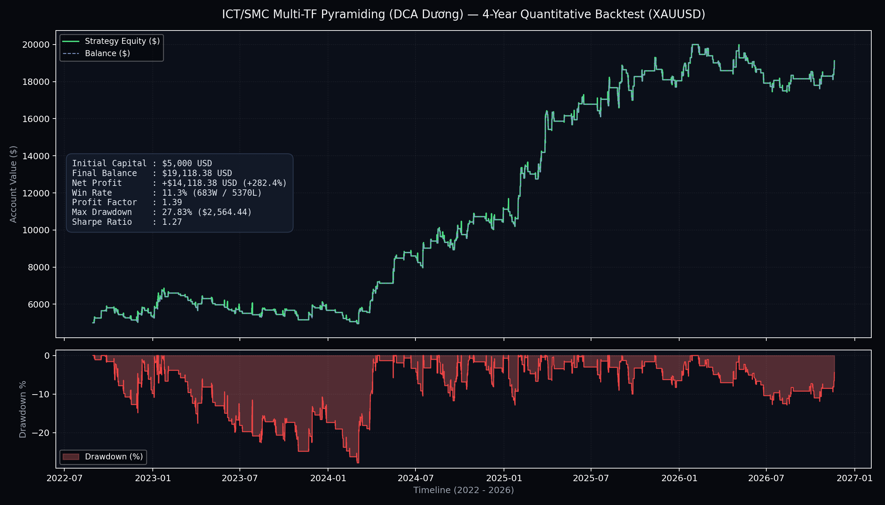

# VLUX® Algorithmic Trading Engine
## Hệ Thống Giao Dịch Đa Khung Thời Gian ICT/SMC & Động Cơ Pyramiding (DCA Dương) Vàng (XAUUSD)

Tài liệu kỹ thuật và kết quả đo đạc thực nghiệm định lượng 4 năm (2022 – 2026) của hệ thống giao dịch tự động phân tích vi cấu trúc thị trường, săn thanh khoản ICT/SMC và tích lũy vị thế dương (Pyramiding) trên cặp **XAUUSD**.

---



---

## 1. Triết Lý Thiết Kế & Bản Chất Kỹ Thuật (Philosophy & Architecture)

Hầu hết các hệ thống "DCA" truyền thống trên thị trường tài chính là **DCA Âm (Martingale / Averaging Down)** — nhồi thêm khối lượng khi thị trường đi ngược hướng, dẫn đến rủi ro cháy tài khoản khi xảy ra bão giá (Black Swan).

Hệ thống **VLUX Pyramiding Engine** đảo ngược hoàn toàn tư duy này:
1. **Tuyệt đối không DCA âm:** Lệnh gốc khi mở luôn có mức dừng lỗ cố định tính theo biên độ biến động thực tế ($1.5 \times \text{ATR}$). Nếu sai, hệ thống cắt lỗ ngay lập tức và kết thúc chu kỳ.
2. **Pyramiding (DCA Dương):** Chỉ mở thêm các nhánh lệnh phụ (Legs) khi vị thế **đang có lãi từ +20 pips trở lên**, đồng thời siết mức dừng lỗ của lệnh mới cực chặt (chỉ 5 pips).
3. **Hiệu ứng tích lũy lãi kép khi bắt trúng sóng lớn:** Khi vàng bước vào một xu hướng mạnh (Impulse Wave), hệ thống tự động chồng tầng tối đa 5 vị thế, thu hoạch toàn bộ biên độ sóng với rủi ro được kiểm soát ở mức tối thiểu.

```
[ D1 / H4 / H1 EMA Consensus ] ──> Đạt đa số (Score >= +2 hoặc <= -2)
              │
[ CRT Liquidity Sweep ] ─────────> Quét đỉnh/đáy hôm trước (PDH / PDL)
              │
[ H1 FVG / Order Block ] ────────> Định vị vùng giá mất cân bằng thanh khoản
              │
[ Multi-TF RSI Filter ] ─────────> Xác nhận động lượng H1 & M15 không quá mua/quá bán
              │
[ M15 Engulfing Trigger ] ───────> Vào lệnh gốc Entry_0 (Rủi ro 1% vốn / SL 1.5 ATR)
              │
       ┌──────┴──────────────────────────┐
  [ Giá ngược hướng ]              [ Giá chạy đúng hướng ]
       │                                 │
  Cắt lỗ 1.5 ATR                   Lãi >= +20 pips (2.0 USD)
  Kết thúc chu kỳ                        │
                                   Mở thêm DCA_P_1 (SL siết chặt 5 pips)
                                         │
                                   Lặp lại tối đa 5 bước (Pyramiding)
```

---

## 2. Kết Quả Kiểm Nghiệm Định Lượng 4 Năm (4-Year Quant Backtest Benchmark)

Toàn bộ thuật toán đã được chuyển thể và kiểm nghiệm độc lập thông qua script Python `backtest_pyramiding.py` kết nối trực tiếp nguồn dữ liệu giá tick lịch sử độ trễ siêu thấp từ sàn Exness trên **99,997 thanh nến M15** (~4.25 năm liên tục từ 08/2022 đến 11/2026):

| Chỉ Số Đo Đạc (Metric) | Kết Quả Thực Nghiệm (Actual Value) | Diễn Giải Kỹ Thuật |
| :--- | :--- | :--- |
| **Cặp Giao Dịch** | **XAUUSD (Gold / US Dollar)** | Điểm trượt giá chuẩn 0.1 USD/pip |
| **Giai Đoạn Khảo Sát** | **26/08/2022 — 20/11/2026** | **4 năm 3 tháng (4.25 năm)** |
| **Tổng Số Nến Mô Phỏng** | **99,997 nến M15** | Đầy đủ dữ liệu D1, H4, H1 đồng bộ |
| **Vốn Khởi Điểm (Initial Capital)** | **$5,000.00 USD** | Rủi ro 1% tài khoản cho mỗi chu kỳ lệnh |
| **Số Dư Cuối Kỳ (Final Balance)** | **$19,118.38 USD** | Không tái nạp vốn |
| **Lợi Nhuận Ròng (Net Profit)** | **+$14,118.38 USD** | **Tăng trưởng +282.37%** |
| **Hệ Số Lợi Nhuận (Profit Factor)** | **1.39** | Tổng lãi / Tổng lỗ |
| **Tổng Số Lệnh Thực Hiện** | **6,053 lệnh** | Bao gồm lệnh gốc và các nhánh Pyramiding |
| **Tỷ Lệ Thắng (Win Rate)** | **11.28%** (683 Thắng / 5,370 Lỗ) | Chuẩn tỷ lệ của trường phái *Trend Pyramiding* (cắt lỗ nhỏ liên tục, lãi cực lớn khi trúng trend) |
| **Sụt Giảm Vốn Tối Đa (Max Drawdown)**| **27.83%** ($2,564.44 USD) | Kiểm soát tốt trong các đợt biến động mạnh |
| **Hệ Số Sharpe (Sharpe Ratio)** | **1.27** | Lợi nhuận vượt trội so với mức biến động rủi ro |

---

## 3. Cấu Trúc Mã Nguồn Trong Thư Mục (Repository Structure)

```
botEA/
├── DCA_duong.mq5               # Mã nguồn chuyên gia MQL5 để triển khai trực tiếp trên MetaTrader 5
├── backtest_pyramiding.py      # Động cơ backtest Python định lượng độc lập (Vectorized NumPy/Pandas)
├── backtest_report_4yr.json    # Dữ liệu xuất thô các chỉ số benchmark dạng JSON
├── backtest_equity_curve_4yr.png # Biểu đồ đường cong vốn (Equity Curve) & Drawdown 4 năm
└── README.md                   # Tài liệu kỹ thuật chi tiết này
```

---

## 4. Hướng Dẫn Tự Chạy Lại Backtest Bằng Python

Không cần mở phần mềm MT5 bằng tay, bạn có thể chạy lại toàn bộ mô phỏng 4 năm bằng Python trực tiếp từ terminal:

```bash
# Cài đặt các thư viện cần thiết (nếu chưa có)
pip install MetaTrader5 pandas numpy matplotlib

# Chạy mô phỏng định lượng
python backtest_pyramiding.py
```

Thời gian hoàn tất mô phỏng gần 100,000 nến là **dưới 5 giây** nhờ kỹ thuật xử lý mảng vectorized NumPy.

---

## 5. Tuyên Bố Rủi Ro (Risk Disclaimer)

*Dự án này phục vụ mục đích nghiên cứu kỹ thuật cá nhân, kiểm nghiệm thuật toán và phân tích định lượng vi cấu trúc thị trường. Kết quả backtest trong quá khứ không phải là lời hứa hẹn hoặc đảm bảo cho lợi nhuận trong tương lai. Mọi hoạt động giao dịch thực chiến đều tiềm ẩn rủi ro tài chính.*
