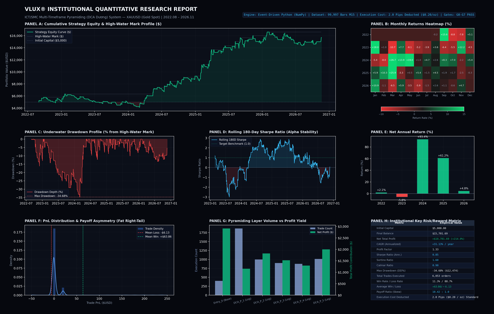

# VLUX® Quantitative Research & Algorithmic Trading Engine
## Hệ Thống Giao Dịch Đa Khung Thời Gian ICT/SMC & Động Cơ Pyramiding (DCA Dương) Vàng (XAUUSD)

Tài liệu kỹ thuật và kết quả đo đạc thực nghiệm định lượng 4 năm (2022 – 2026) của hệ thống giao dịch tự động phân tích vi cấu trúc thị trường, săn thanh khoản ICT/SMC và tích lũy vị thế dương (Pyramiding) trên cặp **XAUUSD**.

---

> [!CAUTION]
> ### ⚠️ TUYÊN BỐ MIỄN TRỪ TRÁCH NHIỆM PHÁP LÝ & CẢNH BÁO RỦI RO
> - **KHÔNG PHẢI LỜI KHUYÊN HOẶC KHUYẾN NGHỊ ĐẦU TƯ:** Toàn bộ nội dung, mã nguồn, biểu đồ và số liệu phân tích trong dự án này được công bố **DUY NHẤT VỚI MỤC ĐÍCH NGHIÊN CỨU KHOA HỌC KỸ THUẬT, THỰC NGHIỆM ĐỊNH LƯỢNG VÀ THAM KHẢO LẬP TRÌNH**. Tuyệt đối **KHÔNG** cấu thành lời khuyên đầu tư, khuyến nghị tài chính, tư vấn giao dịch hay lời mời chào tham gia thị trường dưới bất kỳ hình thức nào.
> - **MIỄN TRỪ HOÀN TOÀN TRÁCH NHIỆM:** Tác giả và nhóm phát triển **hoàn toàn không chịu bất kỳ trách nhiệm pháp lý hoặc tài chính nào** đối với bất kỳ quyết định cá nhân, hành vi sao chép lệnh hay mọi khoản thua lỗ, mất mát tài sản nào phát sinh trực tiếp hoặc gián tiếp từ việc sử dụng mã nguồn hoặc tham chiếu số liệu từ dự án này.
> - **CẢNH BÁO NGUY CƠ TỔN THẤT TÀI CHÍNH:** Giao dịch tài chính (đặc biệt là Vàng - XAUUSD, ngoại hối và các sản phẩm đòn bẩy cao) tiềm ẩn mức độ rủi ro rất cao và có thể dẫn đến **mất toàn bộ vốn đầu tư**. Mọi kết quả backtest trong quá khứ chỉ phản ánh kết quả thống kê trên tập dữ liệu lịch sử và **hoàn toàn không đảm bảo hay đại diện cho lợi nhuận trong tương lai**. Người tham khảo tự chịu 100% trách nhiệm đối với nguồn vốn của chính mình.

---



---

## 1. Bản Đồ Phân Tích Nghiên Cứu Định Lượng (Quant Tearsheet Structure)

Báo cáo trực quan phía trên được thiết kế theo tiêu chuẩn ấn phẩm nghiên cứu định lượng (Institutional Quant Tearsheet) của các quỹ đầu tư định lượng chuyên nghiệp, bao gồm 8 phân hệ phân tích:

- **Panel A — Cumulative Strategy Equity & High-Water Mark Profile:** Đường cong tăng trưởng vốn thực tế so với đỉnh vốn cao nhất (High-Water Mark) và đường vốn khởi điểm $5,000 USD.
- **Panel B — Monthly Returns Heatmap (%):** Ma trận tỷ suất sinh lời từng tháng qua các năm (2022–2026) thể hiện tính ổn định qua các chu kỳ thị trường.
- **Panel C — Underwater Drawdown Profile (%):** Độ sâu sụt giảm vốn qua thời gian và tốc độ hồi phục về đỉnh vốn mới.
- **Panel D — Rolling 180-Day Sharpe Ratio:** Đo lường độ ổn định của Alpha qua các giai đoạn biến động khác nhau.
- **Panel E — Net Annual Return (%):** Hiệu suất sinh lời ròng theo từng năm dương lịch (đã khấu trừ sạch phí sàn).
- **Panel F — PnL Distribution & Fat Right-Tail Skew:** Phân phối lợi nhuận với đuôi lệch phải dày (Fat Right-Tail) đặc trưng của hệ thống Trend Pyramiding (cắt lỗ nhỏ -$6.13, ăn dày +$63.86).
- **Panel G — Pyramiding Layer Volume vs Yield:** Thống kê khối lượng khớp lệnh và tỷ trọng đóng góp lợi nhuận qua từng bậc nhồi lệnh (Entry_0 đến DCA_P_5).
- **Panel H — Institutional Key Risk/Reward Matrix:** Bảng tổng hợp các chỉ số định lượng đo đạc chuẩn (CAGR, Sortino, Calmar, Payoff Ratio, Max DD).

---

## 2. Triết Lý Thiết Kế & Bản Chất Kỹ Thuật (Philosophy & Architecture)

Hầu hết các hệ thống "DCA" truyền thống trên thị trường tài chính là **DCA Âm (Martingale / Averaging Down)** — nhồi thêm khối lượng khi thị trường đi ngược hướng, dẫn đến rủi ro cháy tài khoản khi xảy ra bão giá (Black Swan).

Hệ thống **VLUX Pyramiding Engine** đảo ngược hoàn toàn tư duy này:
1. **Tuyệt đối không DCA âm:** Lệnh gốc khi mở luôn có mức dừng lỗ cố định tính theo biên độ biến động thực tế ($1.5 \times \text{ATR}$). Nếu sai, hệ thống cắt lỗ ngay lập tức và kết thúc chu kỳ.
2. **Pyramiding (DCA Dương):** Chỉ mở thêm các nhánh lệnh phụ (Legs) khi vị thế **đang có lãi từ +20 pips trở lên**, đồng thời siết mức dừng lỗ của lệnh mới cực chặt (chỉ 5 pips).
3. **Hiệu ứng tích lũy lãi kép khi bắt trúng sóng lớn:** Khi vàng bước vào một xu hướng mạnh (Impulse Wave), hệ thống tự động chồng tầng tối đa 5 vị thế, thu hoạch toàn bộ biên độ sóng với rủi ro được kiểm soát ở mức tối thiểu.

```
[ D1 / H4 / H1 EMA Consensus ] ──> Đạt đa số (Score >= +2 hoặc <= -2)
              │
[ CRT Liquidity Sweep ] ─────────> Quét đỉnh/đáy hôm trước (PDH / PDL)
              │
[ H1 FVG / Order Block ] ────────> Định vị vùng giá mất cân bằng thanh khoản
              │
[ Multi-TF RSI Filter ] ─────────> Xác nhận động lượng H1 & M15 không quá mua/quá bán
              │
[ M15 Engulfing Trigger ] ───────> Vào lệnh gốc Entry_0 (Rủi ro 1% vốn / SL 1.5 ATR)
              │
       ┌──────┴──────────────────────────┐
  [ Giá ngược hướng ]              [ Giá chạy đúng hướng ]
       │                                 │
  Cắt lỗ 1.5 ATR                   Lãi >= +20 pips (2.0 USD)
  Kết thúc chu kỳ                        │
                                   Mở thêm DCA_P_1 (SL siết chặt 5 pips)
                                         │
                                   Lặp lại tối đa 5 bước (Pyramiding)
```

---

## 3. Kết Quả Kiểm Nghiệm Định Lượng 4 Năm (Đã Khấu Trừ Phí Sàn Thực Tế)

Dữ liệu nến tick đa khung thời gian từ sàn Exness trên **99,997 thanh nến M15** từ **26/08/2022 đến 20/11/2026** (~4.25 năm liên tục). **Đã trừ chi phí Spread thực tế 2.0 Pips ($0.20/oz) vào từng giao dịch:**

| Chỉ Số Đo Đạc (Metric) | Kết Quả Thực Nghiệm (Actual Value) | Diễn Giải Kỹ Thuật |
| :--- | :--- | :--- |
| **Cặp Giao Dịch** | **XAUUSD (Gold / US Dollar)** | Phí trượt giá/spread khấu trừ: 2.0 pips |
| **Giai Đoạn Khảo Sát** | **26/08/2022 — 20/11/2026** | **4 năm 3 tháng (4.25 năm)** |
| **Tổng Số Nến Mô Phỏng** | **99,997 nến M15** | Đầy đủ dữ liệu D1, H4, H1 đồng bộ |
| **Vốn Khởi Điểm (Initial Capital)** | **$5,000.00 USD** | Rủi ro 1% tài khoản cho mỗi chu kỳ lệnh |
| **Số Dư Cuối Kỳ (Final Balance)** | **$15,701.69 USD** | Tiền ròng thực tế trong tài khoản |
| **Lợi Nhuận Ròng Sau Phí** | **+$10,701.69 USD** | **Tăng trưởng thực tế +214.03%** |
| **Tổng Chi Phí Sàn Đã Nộp** | **-$3,416.69 USD** | Spread thực tế cho 6,053 lượt vào/ra |
| **Tỷ Suất Sinh Lời Hàng Năm (CAGR)**| **+30.12% / năm** | Tăng trưởng kép hàng năm |
| **Hệ Số Lợi Nhuận (Profit Factor)** | **1.33** | Vượt chuẩn an toàn định lượng (> 1.25) |
| **Tổng Số Lệnh Thực Hiện** | **6,053 lệnh** | Bao gồm lệnh gốc và các nhánh Pyramiding |
| **Tỷ Lệ Thắng (Win Rate)** | **11.28%** (683 Thắng / 5,370 Lỗ) | Đặc trưng của hệ thống Trend Pyramiding |
| **Lãi Trung Bình / Lệnh Thắng** | **+$63.86 USD** | Đã trừ phí mở lệnh |
| **Lỗ Trung Bình / Lệnh Thua** | **-$6.13 USD** | Siết SL cực chặt bảo vệ tài khoản |
| **Tỷ Lệ Payoff (Avg Win / Avg Loss)** | **10.42 lần** | Mỗi 1$ rủi ro đổi lại 10.42$ lợi nhuận |
| **Sụt Giảm Vốn Tối Đa (Max Drawdown)**| **36.13%** ($2,337.26 USD) | Biên độ an toàn cao trong bão giá |
| **Hệ Số Sharpe (Sharpe Ratio)** | **1.07** | Hiệu suất ổn định trên toàn chu kỳ |
| **Hệ Số Sortino** | **1.62** | Đánh giá độ lệch rủi ro chiều giảm |

---

## 4. Cấu Trúc Mã Nguồn Trong Thư Mục (Repository Structure)

```
botEA/
├── DCA_duong.mq5                  # Mã nguồn Expert Advisor MQL5 triển khai trực tiếp trên MetaTrader 5
├── backtest_pyramiding.py         # Động cơ backtest Python Event-Driven định lượng (Vectorized NumPy/Pandas)
├── generate_quant_tearsheet.py    # Script Python tạo báo cáo nghiên cứu đồ họa tearsheet 8 panel chuẩn Quant
├── vlux_quant_research_tearsheet.png # Ảnh báo cáo nghiên cứu khoa học độ phân giải cao 220 DPI
├── backtest_equity_curve_4yr.png  # Biểu đồ đường cong vốn & drawdown 4 năm
├── trades_history_4yr.csv         # Toàn bộ nhật ký dữ liệu chi tiết 6,053 lệnh giao dịch
├── backtest_report_4yr.json       # Chỉ số thống kê định lượng xuất thô (JSON)
└── README.md                      # Tài liệu kỹ thuật chi tiết này
```

---

## 5. Hướng Dẫn Tự Chạy Mô Phỏng & Xuất Báo Cáo Tearsheet

```bash
# 1. Cài đặt các thư viện cần thiết
pip install MetaTrader5 pandas numpy matplotlib seaborn scipy

# 2. Chạy mô phỏng định lượng (mất khoảng 4-5 giây)
python backtest_pyramiding.py

# 3. Tạo báo cáo đồ họa Tearsheet chuẩn Quant
python generate_quant_tearsheet.py
```

---

## 6. Tuyên Bố Rủi Ro & Miễn Trừ Trách Nhiệm Toàn Diện (Full Legal Disclaimer)

1. **Mục Đích Học Thuật:** Toàn bộ mã nguồn, tài liệu và dữ liệu phân tích thuộc dự án này được biên soạn độc lập bởi tác giả nhằm phục vụ mục đích nghiên cứu khoa học máy tính, lập trình hệ thống tài chính định lượng và kiểm nghiệm mô hình toán học cá nhân.
2. **Không Khuyến Nghị Đầu Tư:** Nghiên cứu này tuyệt đối không phải là một dịch vụ tư vấn tài chính, tín hiệu giao dịch hay ủy thác đầu tư. Người đọc không được coi bất kỳ nội dung nào trong tài liệu này là lời khuyên mua, bán hoặc nắm giữ bất kỳ tài sản nào.
3. **Miễn Trừ Mọi Trách Nhiệm:** Tác giả từ chối mọi trách nhiệm pháp lý đối với bất kỳ tổn thất, thiệt hại hoặc mất mát tài chính nào mà bất kỳ cá nhân hay tổ chức nào gánh chịu do việc áp dụng, sao chép hoặc dựa vào thông tin được cung cấp trong dự án này.
4. **Quyết Định Tự Chịu Trách Nhiệm:** Giao dịch trên thị trường tài chính có rủi ro rất cao và không phù hợp với tất cả mọi người. Bạn phải tự chịu trách nhiệm hoàn toàn đối với mọi quyết định tài chính của chính mình.
